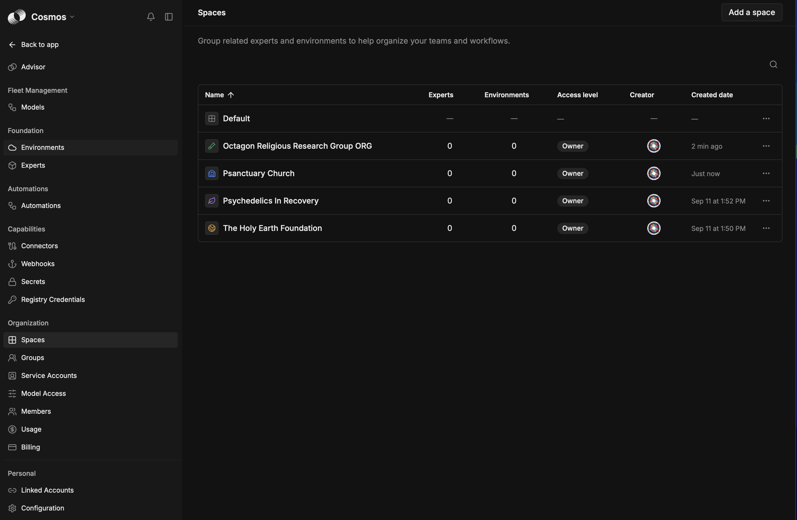

# 🏛️ How we use Cosmos Spaces

**TL;DR:** **one Space per organization.** Each Space holds that organization's helpers, cloud
workspaces, sessions, secrets and connections, so the custodian can care for several organizations without
mixing them up.

A newcomer's Space is set up to be **safe to play in without being a cage**:
- a helper that already knows the house rules;
- private sessions for trying things;
- everything lands on rehearsal first;
- room to grow when the team is ready.

*The Spaces as created on 2026-10-05.*
- **The Holy Earth Foundation** and **Psychedelics in Recovery** came first (2026-09-11), then
  **Psanctuary Church** and **ORG**.
- **Psanctuary** joins when it's ready.
- The **Default** space always exists and can't be removed.

---

## 🧱 What goes in each organization's Space

| In the Space | For The Holy Earth Foundation (the pilot) |
|---|---|
| **Environment** | One cloud workspace with the foundation's site repositories (`iamoneself-retreats`, `david-amaringo` and the proposals). Cosmos's default image already has Node 22 |
| **Default Expert** | **THEF Site Helper.** Its instructions: read `AGENTS.md`, sync, work on `preview`, update the Spanish twin, build, credit the work, explain the change in plain words |
| **Review Expert** | Wakes on a **pull request into `preview`**. It checks the house rules, the never-publish rule, Spanish coverage and the build, and leaves a friendly comment. It never merges |
| **Sessions** | Kenney's are **private** by default (a place to try ideas); shared when he wants company |
| **Files** | Shared foundation notes: the glossary, the voice, decisions. **Never secrets.** Personal notes stay private |
| **Skills** | The same skills our other helpers use (for example "update a page in both languages") |
| **MCP servers** | Firecrawl (research) and Wix (the main site), shared only with the foundation's members |
| **Secrets** | Only what the Experts truly need, **Used in: this Space only** |

## 🔐 Access, the way Cosmos actually works

- **Choosing a Space doesn't grant access.** A Space is a room, not a key. Who may *use* an Expert, an MCP
  server or a secret is granted on that resource (**Manage access → Can use**), to a person or a **Group**.
- **A Group per organization:** for example *THEF stewards* (Kenney and Christopher). Share the Space's
  Experts and connections with the Group, and new members are included the day they join.
- **Whoever creates a Space owns it.** Renaming, defaults and membership need the Space's owner or an
  organization admin.
- **Secrets:** grant *use* on the secret itself, **and** set where it's *Used in*. Sharing an MCP server
  doesn't share the secret it depends on.
- **Check as the person:** after any change, start a fresh session in the Space *as the person it's meant
  for*, and confirm what they can and can't do, without ever printing a secret.

Sources:
- [Cosmos Spaces](https://docs.augmentcode.com/cosmos/spaces/overview)
- [Managing Spaces](https://docs.augmentcode.com/cosmos/spaces/managing)
- [Admin checklist](https://docs.augmentcode.com/cosmos/guides/admin-checklist)

## 🧑‍🌾 Kenney's first week in the foundation's Space

1. **Open Cosmos → The Holy Earth Foundation.** The Site Helper is the default.
2. **Try something small in a private session:** *"Show me the FAQ answer about what to bring, in English
   and Spanish."*
3. **Make a change:** *"Add a line about bringing a journal. Update the Spanish too. Open a pull request
   into preview."*
4. **Watch the review Expert** comment on the pull request, then look at the rehearsal site.
5. **Promote it** from the cockpit when it feels right.

Nothing in that week can touch the live site without his own "Promote".

## 🌳 Growing the Space, when the team is ready

| Next step | What it adds |
|---|---|
| More repositories in the Environment | The foundation's portal and changelog |
| A scheduled Expert | A weekly check: broken links, Spanish lines waiting for review, the Wix site's changes (with Firecrawl) |
| A "first responder" Expert | Turns a visitor's question into a draft answer for Kenney to bless |
| Wider GitHub App access | Owners widen the repositories it may see |
| A shared Space with David | David's site, and his own review of the Spanish |

## 🔗 Related

- [Why Cosmos](../proposals/WHY-COSMOS.md): the case for it.
- [Join an organization](https://github.com/drasticstatic/my-template/blob/main/walkthroughs/JOIN-AN-ORGANIZATION.md): how a newcomer connects Cosmos and their other helpers.
- [COSMOS_AGENT_ROLE_REFERENCE.md](https://github.com/drasticstatic/anthropas-argus-alfred-public-preview/blob/main/sandbox/COSMOS_AGENT_ROLE_REFERENCE.md): the fleet's Cosmos Advisor and review experts.
